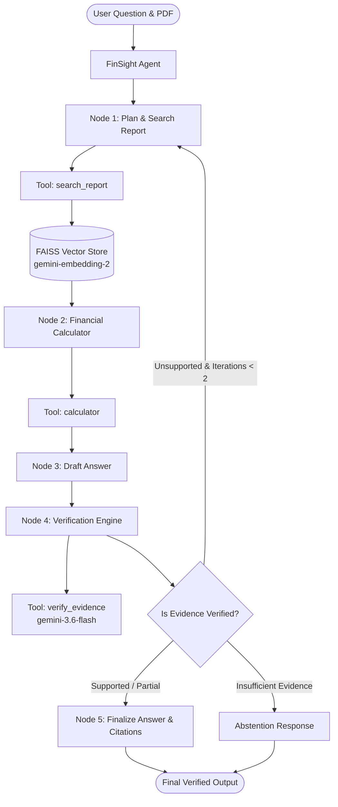

# FinSight — Autonomous Annual Report Analysis & Verification Agent

> **FinSight** is an AI agent that analyzes annual-report PDFs, autonomously searches for relevant financial evidence, performs calculations using tools, verifies its answers against the original source, and responds with page-level citations.

---

## 1. Problem Statement

Large Language Models (LLMs) often suffer from hallucinations, unit confusion, and arithmetic errors when asked complex financial questions about long annual reports (e.g. 300+ page PDFs). A standard "PDF -> RAG -> LLM -> Answer" pipeline cannot perform step-by-step verification, handle multi-page evidence, or calculate percentage growth accurately.

## 2. Solution Architecture

FinSight uses a **LangGraph-orchestrated agent** that dynamically decides which tools to call, performs financial arithmetic using a dedicated calculator tool, verifies every claim against retrieved evidence, and abstains from answering if evidence is insufficient.



---

## 3. Technology Stack

* **Language:** Python 3.11+ / 3.13
* **LLM Engine:** Google Gemini (`gemini-3.6-flash`) via `google-genai` SDK
* **Vector Embeddings:** Google Gemini (`gemini-embedding-2` - 3072 dims)
* **Agent Framework:** LangGraph (`StateGraph`)
* **Document Processing:** PyMuPDF (`pymupdf`)
* **Vector Indexing:** FAISS (`faiss-cpu`)
* **User Interface:** Streamlit
* **Configuration:** `python-dotenv`

---

## 4. Agent Tools & Capabilities

1. **`search_report(query)`**: Performs hybrid semantic vector search (`faiss-cpu`) and financial statement table retrieval to extract text snippets with 1-indexed page citations.
2. **`calculator(expression)`**: Evaluates financial formulas (percentage change, difference, margin) safely using Python's AST parser to prevent mental arithmetic errors.
3. **`verify_evidence(claim, source_evidence)`**: Audits draft answers against retrieved PDF source text to verify numerical values, fiscal years (e.g. FY2025 vs FY2026), units (crore vs million), and context (Standalone vs Consolidated).

---

## 5. Hallucination & Abstention Policy

If the uploaded annual report does not contain sufficient evidence to answer a question, FinSight strictly abstains:

> *"I couldn't find sufficient evidence in the uploaded annual report to answer this reliably."*

This prevents inventing numbers or hallucinating non-existent facts.

---

## 6. Real Failure Discovered During Testing & Engineering Fix

### Failure Discovered
During Milestone 10 integration testing over 1,200+ document chunks, the Gemini API thrown a `429 RESOURCE_EXHAUSTED` rate limit error when processing bulk embeddings rapidly, causing initial index builds to crash.

### Engineering Fix
Implemented exponential backoff retry logic (`GeminiEmbedder.embed_texts` in `rag/embeddings.py`) with configurable batch throttling (batch size = 20, 0.5s pause) and automatic single-item fallback when quota limits are reached.

---

## 7. How to Run Locally

### 1. Clone & Setup Virtual Environment (Windows)

```powershell
python -m venv .venv
.\.venv\Scripts\Activate.ps1
```

### 2. Install Dependencies

```powershell
pip install -r requirements.txt
```

### 3. Configure Environment Variables

Create a `.env` file in the root directory:

```env
GEMINI_API_KEY=YOUR_GEMINI_API_KEY_HERE
```

*(Note: Never commit `.env`. It is excluded by `.gitignore`.)*

### 4. Run Streamlit Application

```powershell
streamlit run app.py
```

---

## 8. Security & Compliance

* **Zero Hardcoded Secrets:** `GEMINI_API_KEY` is loaded strictly from environment variables (`config.py`).
* **Git Hygiene:** `.env`, `.venv/`, `faiss_store/`, and Python bytecode are excluded via `.gitignore`.
* **Safe AST Evaluation:** Calculator tool evaluates math expressions strictly using AST AST nodes without `eval()` security risks.
